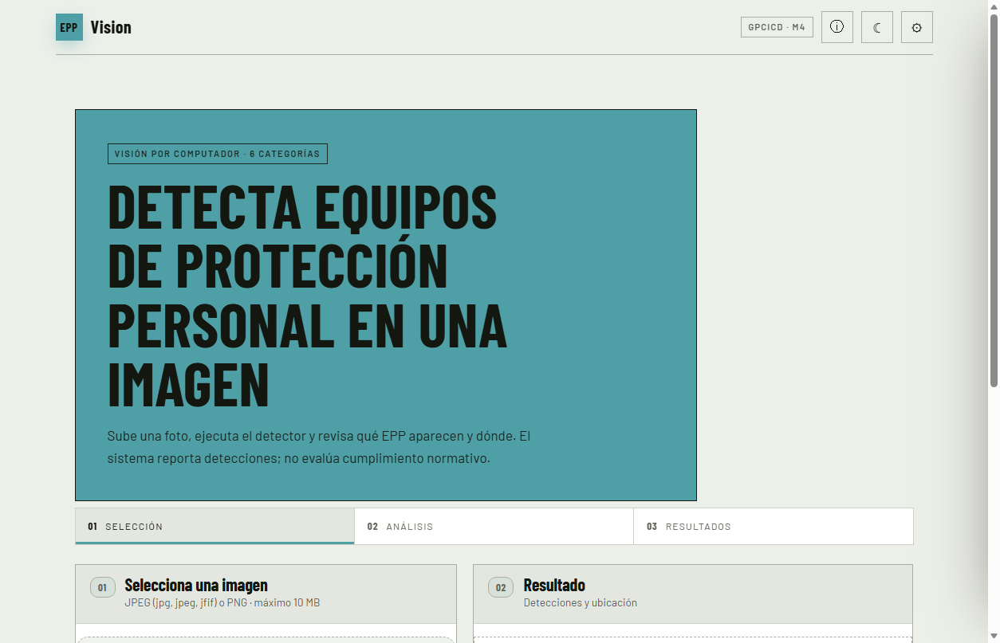
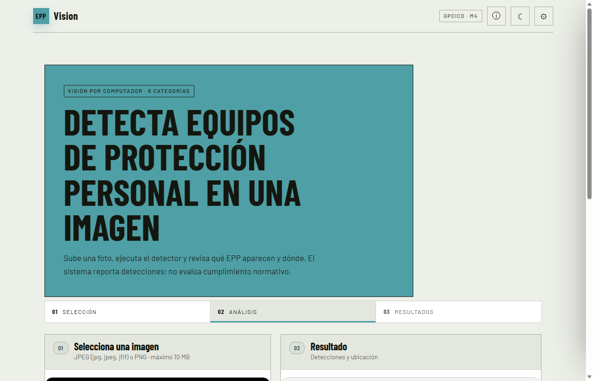
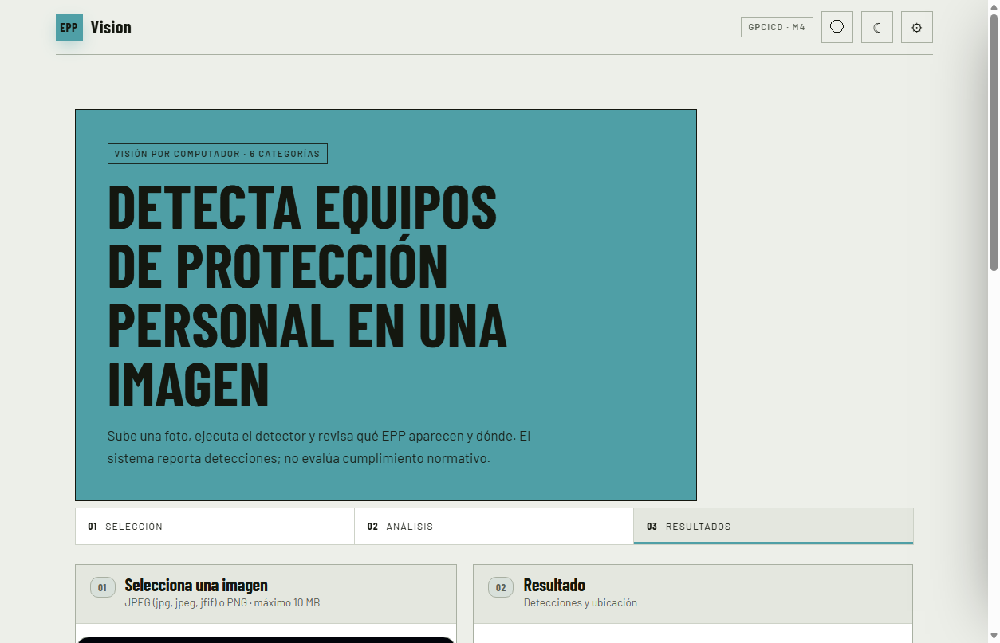

# Manual de usuario de la SPA

> HU-058 · issue #114 · Manual para usar el detector de Equipos de Protección Personal
> (EPP) desde el navegador. Describe la interfaz rediseñada por HU-077 (PR #267).

Este manual explica qué hacer desde que eliges una imagen hasta que lees el resultado.
No necesitas conocimientos técnicos. Si algo no coincide con lo que ves, revisa la
sección [6. Si algo falla](#6-si-algo-falla) y el [catálogo de errores](./errores.md).

## 1. Qué necesitas

- Un navegador actual (Chrome, Edge o Firefox).
- Una foto en **JPEG** (`.jpg`, `.jpeg`, `.jfif`) o **PNG** (`.png`), de hasta **10 MB**.
- Acceso al sitio web del detector. Si el sitio pide usuario y contraseña, solicítalos
  a la persona que operó el despliegue; este manual no guarda credenciales.
- Opcional: una imagen de ejemplo con casco, chaleco o guantes visibles.

> **Aviso sobre las imágenes de este manual:** las cuatro capturas se tomaron en una
> ejecución **local** de la SPA con una **API simulada**, para que el flujo sea
> reproducible sin modelo ni conexión a Internet, y no es una validación del sitio remoto
> ni una medición del despliegue.

## 2. Qué verás

En la parte superior aparece **EPP Vision** y la etiqueta **GPCICD · M4**. Debajo verás
tres pasos numerados:

| Paso | Nombre | Qué significa |
|---|---|---|
| **01** | Selección | Elegiste una imagen y puedes verla antes de analizarla. |
| **02** | Análisis | El detector está procesando la imagen. |
| **03** | Resultados | Terminó el análisis y puedes leer el resumen y la tabla. |

El paso activo se resalta; los anteriores aparecen como completados. En la esquina
superior hay botones para cambiar el tema, abrir la configuración y consultar
**Acerca del modelo**.

## 3. Flujo paso a paso

### 3.1 01 Selección

1. Arrastra la imagen hasta el recuadro **Arrastra tu imagen aquí**, o pulsa
   **Elegir imagen** y selecciónala desde tu equipo.
2. Verás la **vista previa** y el nombre del archivo debajo del recuadro.
3. Si quieres cambiarla, pulsa **Cambiar imagen**.
4. Comprueba que la foto esté enfocada y que los EPP que quieres revisar sean visibles.

### 3.2 02 Análisis

Pulsa **Analizar imagen**. Durante unos segundos verás el mensaje **Analizando…** y una
barra de progreso. Mantén la ventana abierta. Si la espera se prolonga, aparece un aviso
indicando que el análisis sigue en curso y puedes usar **Reintentar** si falla.

### 3.3 03 Resultados

Cuando termina, el paso **03 Resultados** queda activo. La imagen se muestra con recuadros
de colores y debajo aparecen el resumen, la leyenda por clase y la tabla de detecciones.

## 4. Leer los resultados

- **Resumen de detecciones:** muestra el total, cuántas clases aparecen, la confianza
  media, el tiempo de inferencia y la versión del modelo.
- **Clases detectadas:** cada color representa una clase (por ejemplo, *Casco*,
  *Chaleco* o *Guantes*), con su cantidad y confianza media.
- **Tabla de detecciones:** lista clase, confianza y coordenadas. Sirve para revisar
  cada objeto individualmente.
- **Descargas:** puedes guardar el resultado en JSON o CSV, o descargar la imagen
  anotada en PNG.
- **Configuración:** el botón de ajustes permite cambiar tema, etiquetas y umbral de
  confianza. Si subes el umbral o filtras clases, el resumen y la leyenda muestran solo
  las detecciones visibles.

## 5. Cuando no hay detecciones

Si el resumen muestra **0** y no aparece leyenda, la SPA muestra el aviso
**«No se detectaron EPP en la imagen»**. Eso **no significa que no haya EPP**: significa
que la inferencia terminó sin errores y no encontró objetos de las clases que el modelo
reconoce con la configuración actual.

Ten en cuenta tres límites:

1. **Clases disponibles:** el modelo reconoce `Gloves`, `Vest`, `goggles`, `helmet`,
   `mask` y `safety_shoe`. No hay clase `person` ni `no-EPP`.
2. **Umbral y filtros:** un **umbral de confianza** alto o los **filtros** de clase pueden
   ocultar detecciones reales. Baja el umbral o vuelve a activar todas las clases antes
   de concluir.
3. **Alcance:** el resultado **no certifica el cumplimiento** de normas de seguridad ni
   evalúa si una persona está correctamente equipada; solo reporta qué EPP aparecen.

Si sigues sin ver detecciones, prueba con otra imagen, mejora la iluminación o el
encuadre y consulta el apartado de interfaz en el [catálogo de errores](./errores.md).

## 6. Si algo falla

| Situación | Qué hacer |
|---|---|
| El archivo no se selecciona | Comprueba que sea JPEG o PNG y que no supere 10 MB. |
| Aparece un mensaje de error de la API | Anota el texto y busca el código en el [catálogo de errores](./errores.md). |
| La imagen tarda mucho | Espera; si persiste, usa **Reintentar** y revisa la conexión. |
| El resumen muestra 0 | Revisa la [sección 5](#5-cuando-no-hay-detecciones). |
| No cargó «Acerca del modelo» | Puede ser un problema del servicio; vuelve a intentarlo más tarde. |

## 7. Verificación

- **Fecha de verificación: 2026-11-28**.
- Capturas generadas desde la SPA local con Vite y API simulada: pasos 01/02/03 y caso
  sin detecciones. No se ejecutó ninguna prueba contra el Droplet para este manual.
- Interfaz documentada: HU-077 / #133, integrada en `develop` por el PR #267.
- Prueba estructural: `uv run pytest -q tests/test_manual_usuario_spa.py` (4 pruebas).
- Especificación: [`specs/059-hu-058-manual-usuario/`](../../specs/059-hu-058-manual-usuario/spec.md).
