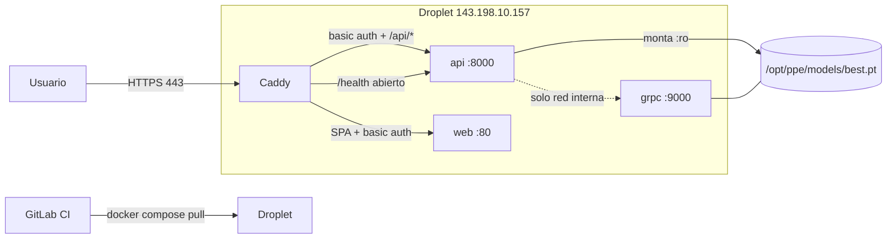

# Despliegue y recuperación — Droplet

> **Qué es:** cómo está montado el sistema en producción, cómo se despliega y cómo se
> vuelve atrás. Cubre **HU-055** (runbook de despliegue), **HU-086** (diagrama) y parte
> de **HU-015** (comprobación del sistema desplegado).
>
> **Última verificación:** 2026-11-27 · `https://143.198.10.157.sslip.io`

## 1. Arquitectura desplegada



| Componente | Dónde | Notas |
|---|---|---|
| Caddy | contenedor `caddy` | TLS automático y basic auth; publica 80/443 |
| API REST | contenedor `api` | interno en 8000; healthcheck `/health/ready` |
| gRPC | contenedor `grpc` | interno en 9000; **no** se publica a internet |
| SPA | contenedor `web` | nginx; interno en 80 |
| Modelo | `/opt/ppe/models/best.pt` | montado `:ro`, verificado por SHA256 |
| Configuración | `/opt/ppe/.env` | dominio, rutas y hash de basic auth |

## 2. Datos del servidor

| Dato | Valor |
|---|---|
| IP | `143.198.10.157` |
| URL | `https://143.198.10.157.sslip.io` (DNS gratuito que apunta a la IP) |
| Usuario SSH | `deploy` (sin contraseña, solo llave; root deshabilitado) |
| Carpeta de trabajo | `/opt/ppe` |
| Acceso al sitio | usuario `demo` · contraseña en el gestor del equipo |
| Coste | `s-1vcpu-2gb` · ~$12/mes, cobrado por hora |

## 3. Despliegue normal (el pipeline)

1. La PR se fusiona en `develop` y el espejo empuja a GitLab (HU-065).
2. En `main`, el pipeline ejecuta `lint → types → specs → test → frontend`.
3. `build_image` construye `runtime` y `web`, hace el smoke de importación y publica en
   el Container Registry del proyecto y en Docker Hub.
4. `deploy` (solo `main`, solo si existe `DEPLOY_HOST`):
   - descarga `best.pt` del Generic Package Registry y verifica el SHA256;
   - copia `compose.prod.yml`, `Caddyfile`, `deploy.sh` y el modelo;
   - ejecuta `deploy.sh <tag>` por SSH.
5. `deploy.sh` guarda el tag en `.deployed_env`, hace `pull`, `up -d`, espera los
   healthchecks e intenta una inferencia real contra `/health/ready`.

### Variables de CI/CD necesarias

| Variable | Tipo | Para qué |
|---|---|---|
| `DEPLOY_HOST` | normal | IP o dominio del Droplet; sin ella el job no se crea |
| `DEPLOY_USER` | normal | `deploy` |
| `SSH_KEY` | **file** | llave privada del usuario `deploy` |
| `PPE_DOMAIN` | normal | dominio del sitio (`143.198.10.157.sslip.io`) |
| `DOCKERHUB_USER` / `DOCKERHUB_TOKEN` | normal / **masked** | espejo público de las imágenes |

## 4. Despliegue manual (sin pipeline)

```bash
ssh -i ~/.ssh/ppe_deploy2 deploy@143.198.10.157
cd /opt/ppe
set -a; . ./.deployed_env; set +a
PPE_API_REPO=guillermozabala/gpcicd-ppe-api \
PPE_WEB_REPO=guillermozabala/gpcicd-ppe-web \
sh deploy.sh <tag>
```

El tag es el `CI_COMMIT_SHORT_SHA` de **8 caracteres** (no 7: GitLab usa 8).

## 5. Rollback

`deploy.sh` guarda el par de imágenes en `/opt/ppe/.deployed_env`.

- **Automático:** si el smoke falla, el script restaura el archivo anterior, hace `pull`
  y `up -d` con el tag previo, y sale con código distinto de cero.
- **Manual:**

```bash
cd /opt/ppe
cat .deployed_env        # el par que está corriendo
PPE_API_REPO=... PPE_WEB_REPO=... sh deploy.sh <tag-anterior>
```

Si el rollback también falla, el script deja los logs y sale con error: no se queda en
silencio.

## 6. Diagnóstico

| Síntoma | Qué mirar |
|---|---|
| 502 en el sitio | `docker compose -f compose.prod.yml ps -a` y `logs api` |
| 401 en todo el sitio | el hash de `PPE_AUTH_HASH` en `.env`; debe ir con `$$` |
| Certificado inválido | que `PPE_DOMAIN` resuelva a la IP y que 80/443 estén abiertos |
| API responde 503 | el modelo no está montado o el SHA no coincide |
| Deploy falla en `pull` | el tag no existe en Docker Hub o el registry |
| `apt-get` bloqueado | `cloud-init status --wait` antes de `provision.sh` |
| Permisos en `/opt/ppe` | `chown -R deploy:deploy /opt/ppe` con Docker si falta sudo |

Comandos útiles:

```bash
docker compose -f compose.prod.yml ps
docker compose -f compose.prod.yml logs --tail 80 api
sha256sum /opt/ppe/models/best.pt
curl -fsS https://<dominio>/health
curl -fsS -u demo:<clave> https://<dominio>/health/ready
```

## 7. Aprovisionamiento desde cero

```bash
DEPLOY_PUBKEY="$(cat ~/.ssh/ppe_deploy2.pub)" sh deploy/droplet/provision.sh
```

Crea el usuario `deploy`, deshabilita root y las contraseñas, activa UFW (22, 80, 443) y
fail2ban, e instala Docker. Es idempotente.

## 8. Apagado

Al terminar la sustentación se destruye el Droplet desde el panel o con el MCP. Antes,
descargar los logs y recordar que el paquete del modelo queda en el registry (no se
pierde).
